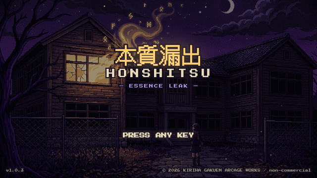

# HONSHITSU — 本質漏出 / ESSENCE LEAK

ダークファンタジー × ドット絵のスコアアタック / アーケードゲーム。
ドライブ「本質images」内の小説『「偏差値60の教室から〝本質〟が漏れ出している件について』』とキャラクター画をモチーフにした **個人利用・非商用** のゲーム。



## 実行方法

```bash
# ローカル配信 (WebAudio / フォント読み込みのため http:// が必要)
python3 -m http.server 8000
# → http://localhost:8000 を開く
```

## 操作方法

| 操作 | キーボード | ゲームパッド |
|---|---|---|
| 移動 | WASD / 矢印 | 左スティック / 十字キー |
| ショット | Z / Enter | A ボタン |
| ダッシュ | X | B ボタン |
| ボム | C | X ボタン |
| ポーズ | Escape | Start |
| 選択 / 決定 / 取消 | 矢印 / Enter / Escape | 十字キー / A / B |

初回入力で AudioContext が起動 (ブラウザの自動再生制限対応)。キーボード / パッドどちらでも全操作でき、画面内プロンプトは入力デバイスに応じて切替。

## 遊び方

* NEW GAME から開始。敵を倒し WAVE を進め、WAVE 5・10・15 のボスと WAVE 20 のラスボスを撃破するとクリア。
* コンボ (8倍まで)・無傷ウェーブボーナス・エッセンス回収でスコアを稼ぐハイスコア形式。ランキングは自動保存。
* 死亡時は **CONTINUE** (10秒以内に決定) でチェックポイントのウェーブから再開 (スコア半減)。
* ESCAPE でポーズ → OPTIONS から BGM / SE / ボイス音量・全画面・操作説明を変更可能 (自動保存)。

## 画面遷移

起動ロゴ → ローディング (進捗バー / ヒント / 素材取得ログ / 動く背景) → タイトル (パララックス背景・タイトルBGM・点滅 PRESS ANY KEY・隅にバージョン / コピーライト) ⇄ メニュー (NEW GAME / CONTINUE / OPTIONS / CREDITS / QUIT) → プレイ (HP/MP・スコア・スキルスロット・残像付きHPバー・フローティングダメージ・トースト・シェイク・ヒットストップ・フラッシュ・パーティクル・追従カメラ先読み込み・カットイン・下部ウィンドウ式ダイアログ) ⇄ ポーズ (暗転・再開 / 設定 / タイトルへ) → リザルト / ゲームオーバー → タイトル。全遷移にフェード / ワイプ。

## 構成

```
index.html            エントリ
css/game.css          レターボックス (16:9 固定 640×360 内部解像度 / スクロール・右クリック無効)
src/core.js           素材マネージャ / WebAudio ミキサー (BGM/SE/VOICE バス・クロスフェード) / 入力 / セーブ
src/ui.js             ドットタイポグラフィ (縁取り/グロー/文字送り) / 9スライスパネル / HPゴーストバー / トースト / フローター
src/data.js           チューニング定数 / 導入台詞 / ウェーブ構成 / クレジット生成
src/play.js           プレイ状態 (弾幕/コンボ/ボス/カットイン/ダイアログ/カメラ)
src/states.js         起動 / ローディング / タイトル / メニュー / 設定 / クレジット / リザルト
src/main.js           ゲームループ (固定タイムステップ) / 状態機械 / フェード
assets/               素材一式 (assets.manifest.json の id でコードから参照)
assets/user/          同 id ファイルで任意の素材に差し替え可能
tools/fetch_assets.py 素材ダウンロード (配布元のライセンス明記リポジトリから正式取得)
tools/gen_licenses.py LICENSES.md 自動生成 (COMMERCIAL_BUILD=true で NC 素材除外)
```

## 素材とライセンス

素材はすべて配布元 (ライセンス明記) から `tools/fetch_assets.py` で正式にダウンロードし、`assets.manifest.json` で一元管理 (id / 作者 / 出典 / ライセンス / 帰属 / 非商用フラグ)。コード内に URL の直接記載なし。詳細は **[LICENSES.md](LICENSES.md)** (manifest から自動生成)。

* 素材パック: Kenney (CC0) / Ironthug (CC0) / lerc (CC0) / 8bit BGM Collection (自由利用・音源単体再販禁止) / FreePD (CC0) / game-icons.net (CC BY 3.0) / Google Fonts (OFL)
* 生成画像 (背景・キービジュアル・カットイン) は本プロジェクト用に生成したオリジナル
* 商用ビルドする場合は `tools/gen_licenses.py` に `COMMERCIAL_BUILD = true` を設定して再生成し、NC (非商用) 素材を除外のこと

## 開発状況

**実装完了** — 起動→ローディング→タイトル→プレイ→ポーズ→ゲームオーバー→再開が途切れず遊べる。描画・全画面遷移・入力は headless スモークテストで検証済み。スクリーンショットは `docs/screenshots/`。
